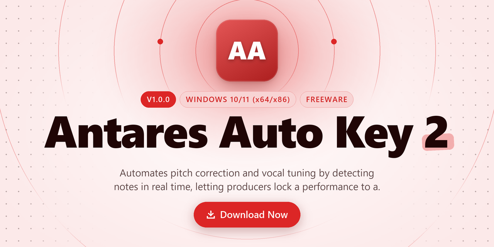

<h1 align="center">Antares Auto Key 2 - Real-Time Vocal Tuning Utility for Windows 10/11</h1>

<p align="center"><i>Antares Auto Key 2 is a real-time pitch detection and vocal tuning tool that snaps takes to a chosen scale and lets producers edit individual notes inside the DAW. This page covers requirements, engine modes, configuration paths, shortcuts, CLI flags, and Windows-specific fixes for studio engineers and power users.</i></p>

<p align="center">&nbsp;&nbsp;&nbsp;&nbsp;&nbsp;&nbsp;&nbsp;&nbsp;</p>

<p align="center"></p>

<p align="center">
  <a href="https://russellmehta28.github.io/antares-auto-key-2/">
    <picture>
      <source media="(prefers-color-scheme: dark)" srcset="./assets/Click-dark.svg">
      
    </picture>
  </a>
</p>

## Table of Contents

<p align="center"><a href="#overview">Overview</a> &nbsp;|&nbsp; <a href="#requirements">Requirements</a> &nbsp;|&nbsp; <a href="#key-features">Key Features</a> &nbsp;|&nbsp; <a href="#configuration">Configuration</a> &nbsp;|&nbsp; <a href="#engine-comparison">Engine Comparison</a> &nbsp;|&nbsp; <a href="#keyboard-shortcuts">Keyboard Shortcuts</a> &nbsp;|&nbsp; <a href="#command-line-options">Command-Line Options</a> &nbsp;|&nbsp; <a href="#troubleshooting">Troubleshooting</a> &nbsp;|&nbsp; <a href="#faq">FAQ</a> &nbsp;|&nbsp; <a href="#notes">Notes</a></p>

## Overview

Antares Auto Key 2 runs as a VST3, AAX, and ARA plug-in inside a host DAW, performing low-latency note detection on a live or recorded vocal track and applying correction against a user-defined scale. It is designed for mix engineers, vocal producers, and songwriters who want tuned takes without leaving the session.

### What It Does

Auto Key 2 detects the fundamental pitch of incoming audio frame by frame, maps each frame to the nearest scale degree, and applies pitch-shifting with adjustable retune speed, humanize, and formant handling. Notes flagged as out of scale can be reassigned to a chromatic grid, a diatonic preset, or a custom user scale.

### Who It Is For

The tool targets tracking and mixing engineers who need fast, non-destructive tuning on a per-note basis. It suits vocal comping workflows inside Pro Tools, Cubase, Studio One, and Reaper, plus producers who prefer to tune before committing a take to the arrangement.

### What Ships in the Build

The installer bundles the plug-in binaries for VST3, AAX, and ARA formats, the standalone Auto Key Settings helper, a preset library organized by genre and scale, and a diagnostic log utility. The Windows package targets 64-bit hosts only.

## Requirements

| Spec | Minimum | Recommended |
| --- | --- | --- |
| OS | Windows 10 21H2 (64-bit) | Windows 11 23H2 (64-bit) |
| CPU | Intel Core i5-6xxx or AMD Ryzen 5 1600 | Intel Core i7-10xxx or AMD Ryzen 7 3700X |
| RAM | 8 GB | 16 GB or more |
| Display | 1280x720, 100% scaling | 1920x1080, 125% scaling |
| Storage | 500 MB free on system drive | 1 GB free on SSD |
| Host / DAW | Any VST3 or ARA host, 64-bit | Pro Tools 2023+, Studio One 6+, Cubase 12+ |
| Latency budget | 256-sample buffer at 44.1 kHz | 128-sample buffer at 48 kHz |

## Key Features

* **Scale-Locked Tuning** , constrains detected notes to a selected major, minor, or custom scale before applying correction.
* **Per-Note Editing** , exposes each detected note as a discrete region that can be dragged chroma-wise or muted individually.
* **Real-Time Detection** , reports pitch, MIDI note, and confidence in under 10 ms at a 128-sample buffer.
* **Retune Speed Control** , sets the attack curve from hard snap to slow glide using a single 0 to 100 slider.
* **Formant Preservation** , shifts pitch while holding formant peaks in place to avoid chipmunk artifacts.
* **ARA Region Sync** , reads the DAW's clip boundaries to align note edits with the arrangement timeline.
* **Preset Packs** , ships with genre presets covering pop, rap, gospel, and EDM vocal chains.
* **Offline Render Mode** , processes a full take in the background at higher accuracy than live mode.

## Configuration

| Path | Purpose |
| --- | --- |
| `%LOCALAPPDATA%\Antares\AutoKey2\config.json` | Per-user engine settings, scale library, and UI state. |
| `%APPDATA%\Antares\AutoKey2\presets\` | User-saved tuning presets and chain snapshots. |
| `%PROGRAMDATA%\Antares\AutoKey2\scales\` | Shared scale definitions readable by all user accounts. |
| `%LOCALAPPDATA%\Antares\AutoKey2\logs\engine.log` | Runtime log for pitch detection and host handshake events. |
| `%PROGRAMDATA%\Antares\AutoKey2\installation.json` | Plug-in format registration and ARA shim manifest. |
| `%APPDATA%\Antares\AutoKey2\autokey-cli.toml` | Default arguments for the helper CLI. |

| Setting | Default | Notes |
| --- | --- | --- |
| `engine_mode` | `balanced` | Accepts `live`, `balanced`, or `offline`; offline favors accuracy. |
| `retune_speed` | `55` | Integer 0 to 100; lower values give slower, more natural glides. |
| `formant_preserve` | `true` | Disabling exposes raw pitch shift and thins the vocal. |
| `scale_lock` | `chromatic` | Default lookup scale before a session scale is chosen. |
| `update_channel` | `stable` | Switch to `beta` for pre-release engine builds. |
| `log_level` | `info` | Options: `error`, `warn`, `info`, `debug`, `trace`. |
| `telemetry_enabled` | `false` | Opt-in anonymous usage metrics; off by default. |
| `ara_region_sync` | `true` | Should stay on unless the host reports ARA handshake errors. |

## Engine Comparison

| Mode | Detection Latency | CPU (single core, 48 kHz) | Peak Accuracy | When to Pick |
| --- | --- | --- | --- | --- |
| `live` | ~6 ms | 4 to 7 % | 92 % | Tracking vocals while the artist performs. |
| `balanced` | ~14 ms | 9 to 13 % | 96 % | Mixing a recorded take with mid-size sessions. |
| `offline` | Full-take render | 30 to 50 % | 99 % | Final print or when chasing a stubborn pitch drift. |
| ARA (host-synced) | n/a (clip-based) | 6 to 10 % | 97 % | Editing note-by-note inside Pro Tools or Studio One. |
| Standalone helper | ~12 ms | 5 to 8 % | 90 % | Quick tuning checks outside a DAW session. |

## Keyboard Shortcuts

| Action | Shortcut |
| --- | --- |
| Toggle bypass on selected plug-in instance | `Ctrl + B` |
| Open scale selector | `Ctrl + Shift + S` |
| Snap selected notes to nearest scale degree | `Ctrl + Shift + N` |
| Mute selected note region | `M` |
| Adjust retune speed by +1 / -1 | `Up Arrow` / `Down Arrow` |
| Adjust retune speed by +10 / -10 | `Shift + Up Arrow` / `Shift + Down Arrow` |
| Reset selected note to detected pitch | `Ctrl + R` |
| Show/hide note grid overlay | `Ctrl + G` |
| Copy selected note edits to clipboard | `Ctrl + C` |
| Paste note edits onto another region | `Ctrl + V` |

## Command-Line Options

| Flag | Argument | Purpose |
| --- | --- | --- |
| `--session` | `path\to\project` | Points the helper at a DAW session to scan for Auto Key 2 instances. |
| `--scale` | `name` or `path\scale.json` | Forces a scale preset before rendering. |
| `--mode` | `live`, `balanced`, `offline` | Overrides the configured engine mode. |
| `--render` | `input.wav output.wav` | Runs an offline tuning pass on a stereo file. |
| `--preset` | `preset-name` | Loads a saved preset chain by name. |
| `--log-level` | `error` to `trace` | Sets the helper's log verbosity. |
| `--validate` | `path\to\config.json` | Checks a config file for syntax and schema errors. |
| `--no-telemetry` | (none) | Disables telemetry for this invocation only. |

```bash
autokey-cli --render "C:\Takes\verse_lead.wav" "C:\Takes\verse_lead_tuned.wav" --mode offline --scale "D major" --preset "pop-lead"
```

| Exit Code | Meaning |
| --- | --- |
| `0` | Render or validation completed with no warnings. |
| `1` | Input file missing or unreadable. |
| `2` | Scale or preset name not found. |
| `3` | Host session lock conflict; close the DAW and retry. |
| `4` | Engine crash during offline render; inspect `engine.log`. |

## Troubleshooting

### Plug-in Does Not Appear in Host After Install

Auto Key 2 is registered but the DAW does not list it under VST3 or ARA instruments.

1. Confirm the DAW is running as 64-bit; Auto Key 2 has no 32-bit build.
2. Verify `%PROGRAMDATA%\Antares\AutoKey2\installation.json` lists the expected VST3 path.
3. Force a plug-in rescan in the DAW's preferences (for example, Cubase's Plug-in Manager or Studio One's Locations tab).
4. If the DAW ships an ARA-only scan, confirm ARA support is enabled in its audio settings.
5. Reinstall and tick the specific host format (VST3, AAX, ARA) manually during setup.

### Pitch Detection Drifts on Long Takes

Detected notes wander from the sung pitch after several bars of a continuous take.

1. Switch `engine_mode` to `offline` and re-render, since live detection trades accuracy for speed.
2. Lower the buffer to 128 samples and rerun the calibration from the Auto Key Control Panel.
3. Clear the host's clip-gain automation before the pass; gain ramps confuse the frame detector.
4. Re-analyze the region by right-clicking in the ARA editor and choosing "Reanalyze Region".
5. Check `%LOCALAPPDATA%\Antares\AutoKey2\logs\engine.log` for dropped-frame warnings.

### Scale Lookup Returns Wrong Notes

Notes snap to the wrong scale degree after switching from chromatic to a preset.

1. Open the scale selector with `Ctrl + Shift + S` and confirm the root and mode match the key of the session.
2. Check whether a per-region scale override is active; overrides win over the session scale.
3. Confirm the shared scale file under `%PROGRAMDATA%\Antares\AutoKey2\scales\` is not stale.
4. Delete the cached scale in `%LOCALAPPDATA%\Antares\AutoKey2\config.json` and restart the host.

### High CPU on Multi-Instance Sessions

Sessions with five or more Auto Key 2 instances stutter during playback.

1. Switch instances that are done being edited to `balanced` or `offline` mode after the take is committed.
2. Freeze or bounce instances on background vocals to reclaim CPU.
3. Set `formant_preserve` to `true` only on lead tracks; disable it on doubles and harmonies.
4. Raise the host buffer to 256 samples while editing, then drop back for mixdown.

## FAQ

### Does Auto Key 2 tune in real time or only on recorded audio?

Both. The plug-in detects pitch as the vocal is tracked, and the ARA and offline modes reprocess a completed take at higher accuracy. Real-time detection at a 128-sample buffer registers under 10 ms on a modern desktop CPU.

### How does Auto Key 2 handle key changes mid-song?

A session scale applies until a per-region scale override is set. Producers can drop markers on a region boundary and assign a new root or mode, and the detector re-locks at each marker without a re-render.

### Can I export the tuned take without committing the plug-in?

Yes. Use the `autokey-cli --render` flag on the source WAV, or bounce the region inside the DAW with the plug-in active. Offline render matches the ARA result within one cent on typical vocal material.

## Notes

Antares, Auto-Tune, and Auto Key are trademarks of Antares Audio Technologies. This documentation is provided for licensed Auto Key 2 users on Windows 10 and Windows 11. Plug-in behavior can vary by host DAW version and audio interface driver.